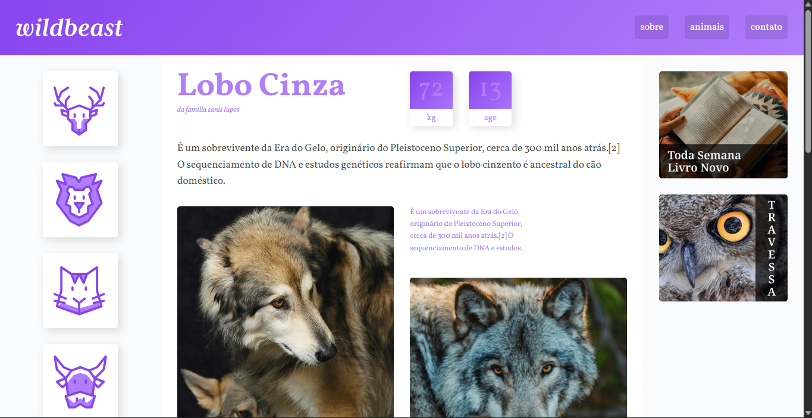
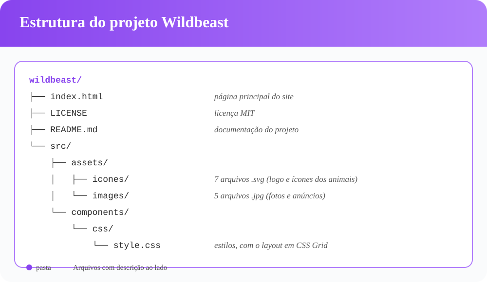

<h1 align="center">Wildbeast</h1>

<p align="center">
  <strong>Um site sobre o lobo cinza, construído com CSS Grid Layout para praticar.</strong>
</p>

<p align="center">
  <a href="https://gabrielfelipeoliveira55.github.io/Wildbeast/">Ver o site</a> ·
  <a href="https://github.com/gabrielfelipeoliveira55/wildbeast">Repositório</a> ·
  <a href="https://github.com/gabrielfelipeoliveira55/wildbeast/issues">Reportar um problema</a>
</p>

<p align="center">
  
</p>

<p align="center">
  
  
  
</p>

<p align="center">
  
  
  
</p>

---

## 📑 Índice

- [O que é](#-o-que-é)
- [Para quem é](#-para-quem-é)
- [Principais recursos](#-principais-recursos)
- [Começando](#-começando)
- [Estrutura do projeto](#-estrutura-do-projeto)
- [Por trás do código](#-por-trás-do-código)
- [CSS Grid ou Flexbox?](#-css-grid-ou-flexbox)
- [Roadmap](#-roadmap)
- [Tecnologias](#-tecnologias)
- [Contribuição](#-contribuição)
- [Créditos](#-créditos)
- [Licença](#-licença)
- [Autor](#-autor)

---

## 💡 O que é

Wildbeast é um site estático sobre animais, com destaque para o **lobo cinzento**. A página apresenta características do animal, curiosidades e fotos em um layout organizado em blocos.

O foco do projeto não é o conteúdo, e sim a **construção do layout**. Ele foi feito para praticar o **CSS Grid Layout** na prática: dividir uma página inteira em áreas, reorganizar essas áreas em telas menores e montar a responsividade sem depender de muitos ajustes manuais.

---

## 🎯 Para quem é

- ✅ Estudantes de front-end que querem ver o CSS Grid aplicado em um site completo
- ✅ Quem já conhece o básico de HTML e CSS e quer entender como montar um layout real
- ✅ Quem quer uma ideia de como estruturar páginas responsivas com Grid

> ⚠️ **Não é para você se:** procura um template pronto para uso comercial ou um projeto focado em conteúdo sobre animais.

---

## ⭐ Principais recursos

| | Recurso | O que ganha você |
|---|---|---|
| 🧭 | Layout principal em CSS Grid com áreas nomeadas | Você vê como organizar a página inteira com `grid-template-areas` |
| 📱 | Responsividade em três tamanhos de tela | Veja a mesma estrutura se reorganizar em 1200px, 760px e 600px |
| 🧩 | Grid aninhado dentro da área principal | Entenda como um grid pode morar dentro de outro |
| 🎨 | Cards e anúncios com `repeat(auto-fit, minmax(...))` | Aprenda a criar colunas que se ajustam sozinhas |
| 📐 | Barra lateral com rolagem horizontal no celular | Veja uma solução de layout para telas pequenas |

---

## 🚀 Começando

Não há instalação. Você pode:

1. **Ver o site publicado:** [gabrielfelipeoliveira55.github.io/Wildbeast](https://gabrielfelipeoliveira55.github.io/Wildbeast/)
2. **Estudar localmente:** clone o repositório e abra o `index.html` no navegador

```bash
git clone https://github.com/gabrielfelipeoliveira55/wildbeast.git
cd wildbeast
```

Para estudar o layout, abra `src/components/css/style.css`. Comece pelo bloco `.grid`, que organiza a página inteira.

---

## 🗂️ Estrutura do projeto



```text
wildbeast/
├── index.html
├── LICENSE
├── README.md
└── src/
    ├── assets/
    │   ├── icones/    # 7 arquivos .svg (logo e ícones dos animais)
    │   └── images/    # 5 arquivos .jpg (fotos e anúncios)
    └── components/
        └── css/
            └── style.css
```

---

## 🔬 Por trás do código

Você já viu **o que** o site faz. Agora veja **como** ele foi construído.

- 🧠 **A decisão mais importante:** o layout inteiro é controlado por um único grid, no elemento `.grid`. Ele define cinco áreas (`header`, `sidenav`, `main`, `ads` e `footer`) e reorganiza essas áreas conforme a largura da tela.
- 📱 **Os breakpoints:** os pontos de quebra em 1200px e 760px seguem tamanhos de tela comuns entre os usuários dos últimos anos. Em telas grandes, parágrafos muito largos ficam difíceis de ler. O layout se adapta para manter o texto em uma largura confortável.
- ⚠️ **O desafio:** o grid principal foi o mais complexo. Ele precisava manter tudo organizado em três tamanhos de tela diferentes. Depois, a área `main` também precisou de um grid próprio, aninhado dentro do grid geral. Entender em qual grid cada elemento estava foi a parte mais difícil.

> 💡 **O que aprendi:** a especificação do CSS Grid é densa, mas usar o Grid é simples quando você entende o layout que quer construir. A melhor forma é pensar em peças pequenas e montar o layout peça por peça, como um quebra-cabeça.

Desenvolver o projeto levou cerca de 4 horas.

---

## ⚖️ CSS Grid ou Flexbox?

Este projeto mostra que **Grid e Flexbox não competem entre si**. Cada um resolve um tipo de problema:

| | Flexbox | CSS Grid |
|---|---|---|
| **Dimensão** | Unidimensional: uma linha ou uma coluna | Bidimensional: linhas e colunas ao mesmo tempo |
| **Melhor para** | Alinhar itens em uma direção, como menus e botões | Organizar a estrutura da página ou um conjunto de cards |
| **Exemplo no Wildbeast** | A lista de links do menu superior | O layout geral da página |

No próprio projeto, os dois são usados juntos. O cabeçalho usa Grid para dividir o logo e o menu, e dentro do menu os links são organizados com Flexbox. Use cada um onde ele faz mais sentido.

---

## 🗺️ Roadmap

O projeto está concluído, mas pretendo evoluí-lo:

- [ ] Adicionar **interatividade ao menu lateral**, para que cada animal abra suas próprias informações
- [ ] Criar páginas para os outros animais (cervo, leão, gato, vaca, ovelha e abelha)

---

## 🛠️ Tecnologias

| Tecnologia | Uso no projeto |
|---|---|
|  | Estrutura da página |
|  | Estilos e layout com CSS Grid e Flexbox |
|  | Fonte Vollkorn |

**Paleta de cores:** roxo `#8844EE` e lilás `#B07DFB`, com gradiente entre os dois.

---

## 🤝 Contribuição

Sugestões, correções e melhorias são bem-vindas.

1. Abra uma [issue](https://github.com/gabrielfelipeoliveira55/wildbeast/issues) descrevendo o que você quer mudar
2. Ou faça um *fork*, crie uma branch e envie um *pull request*

```bash
git checkout -b seuNomeDoGithub-contribution-oQueVaiTrazerDeNovo
git commit -m "Descrição da alteração"
git push origin seuNomeDoGithub-contribution-oQueVaiTrazerDeNovo
```

Não tem experiência com Git? Abrir uma issue com uma dúvida ou sugestão já é uma contribuição.

---

## 🙏 Créditos

Projeto originalmente desenvolvido pela **[Origamid](https://www.origamid.com/)**. O projeto foi reconstruído como prática de CSS Grid Layout, e o crédito é mantido aqui por respeito ao trabalho original.

---

## 📄 Licença

Distribuído sob a **Licença MIT**. Você pode usar, copiar, modificar e distribuir este projeto, inclusive em projetos comerciais, desde que mantenha o aviso de copyright. Veja o arquivo [`LICENSE`](LICENSE) para o texto completo.

---

## 👤 Autor

**Gabriel Felipe de Oliveira Rateiro**

[](https://github.com/gabrielfelipeoliveira55)

📧 gabrielfeliperateirooficial@gmail.com · gabrielfelipeoliveiradd@gmail.com

Gostou do projeto? Deixe uma ⭐ no repositório para ajudar outras pessoas a encontrá-lo.
